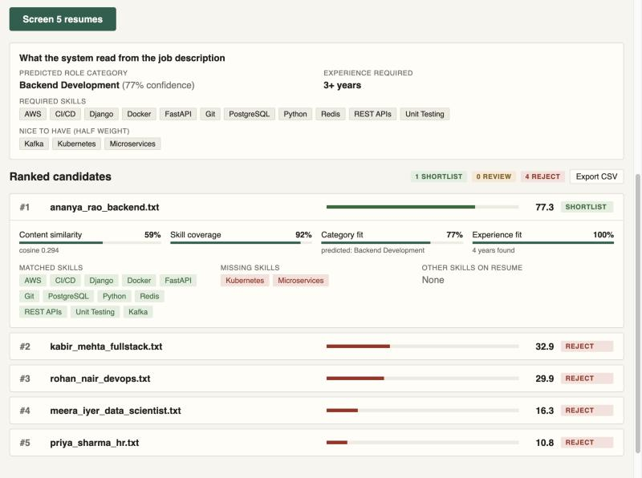
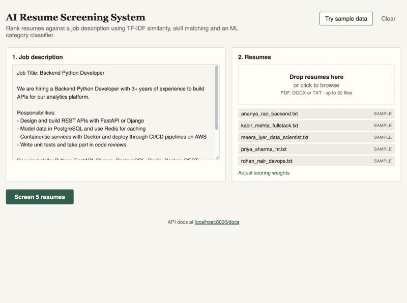

# AI Resume Screening System

[](https://github.com/rishigolechha75-ux/ai-resume-screening-system/actions/workflows/ci.yml)

An NLP and machine-learning system that **ranks candidate resumes against a job description**. It combines TF-IDF similarity scoring, skill matching and a job-category classifier. You can use it through a **REST API (FastAPI)** or an **interactive web interface (React)**.



<details>
<summary>Input screen</summary>


</details>

## Features

- **Upload resumes** as PDF, DOCX or TXT (up to 50 at a time). Unreadable files are reported, not silently dropped.
- **Job description analysis**: extracts required vs. nice-to-have skills, the years of experience required, and the role category.
- **Experience detection** from phrases like "4 years of experience" or, if none are stated, from dated ranges such as "Jun 2025 – Present" (overlaps merged, education year ranges ignored).
- **Hybrid scoring** of every resume on four explainable components, combined into a 0–100 score.
- **Recommendation** for each candidate: *Shortlist* (≥ 60), *Review* (40–60) or *Reject* (< 40).
- **Explanations**: matched, missing and extra skills for each candidate, plus a per-component score breakdown.
- **Adjustable weights** in the UI or the API, so recruiters can decide what matters most.
- **CSV export** of the ranked shortlist.

## How it works

```
                Job description ───────────┐
                                           ▼
 Resumes (PDF/DOCX/TXT) ─► Text extraction ─► Cleaning ─┬─► TF-IDF vectors ──► Cosine similarity ─┐
                                                        ├─► Skill extractor ─► Skill coverage ────┤
                                                        ├─► ML classifier ───► Category fit ──────┼─► Weighted score ─► Ranking
                                                        └─► Regex parser ────► Experience fit ────┘
```

| Component | Weight | How it is computed |
|---|---|---|
| Content similarity | 0.40 | TF-IDF (1–2 grams) cosine similarity between the JD and the resume. A cosine of 0.5 or more counts as a full match |
| Skill coverage | 0.35 | Share of the JD's skills found in the resume, from a taxonomy of 94 skills with aliases (e.g. `k8s` → Kubernetes). Nice-to-have skills count half |
| Category fit | 0.15 | Probability, from the classifier, that the resume belongs to the JD's predicted job category |
| Experience fit | 0.10 | Candidate's years of experience ÷ years required (capped at 1) |

The **category classifier** is a scikit-learn pipeline (TF-IDF + Logistic Regression) trained on labelled resumes across 8 job categories: Data Science, Frontend Development, Backend Development, DevOps Engineering, Mobile Development, Human Resources, Sales & Marketing, and Finance & Accounting.

## Results

All numbers below come from `scripts/train.py` and `scripts/evaluate_ranking.py`, and are saved in [`backend/reports/`](backend/reports).

**Category classifier** (480 resumes, stratified 80/20 split + 5-fold cross-validation):

| Model | Test accuracy | Macro F1 | 5-fold CV accuracy |
|---|---|---|---|
| **Logistic Regression (used)** | **85.4%** | **0.854** | **85.0% ± 1.6%** |
| Linear SVM | 83.3% | 0.832 | 84.0% ± 3.1% |
| Multinomial Naive Bayes | 83.3% | 0.831 | 82.7% ± 1.9% |

The categories that get confused most are Backend vs Frontend Development (F1 0.70 and 0.78), which overlap in real life too. Human Resources is the easiest (F1 1.00).

**Ranking quality**: for each of 40 job descriptions, 96 unseen resumes were ranked. A resume counts as relevant if its category matches the job's.

| Ranker | Precision@5 | Precision@10 | NDCG@10 |
|---|---|---|---|
| TF-IDF similarity only (baseline) | 0.800 | 0.740 | 0.775 |
| Skill matching only | 0.790 | 0.673 | 0.731 |
| **Hybrid score (this system)** | **0.910** | **0.823** | **0.859** |

The hybrid score puts the right candidates in the top 5 **91% of the time vs 80% for plain TF-IDF**, an 11-point gain.

> About the data: public resume datasets often carry privacy or licensing restrictions, so this repository ships a **synthetic, reproducible dataset** (`scripts/generate_dataset.py`). All names and companies in it are fictional. To keep the task realistic, resumes blend in content from neighbouring roles (e.g. full-stack profiles), use generic titles like "Software Engineer", and share generic duties. You can retrain on any real dataset with `Category` and `Resume` columns, such as the public Kaggle "Resume Dataset": `python scripts/train.py --data path/to/UpdatedResumeDataSet.csv`.

## Tech stack

| Layer | Technology |
|---|---|
| NLP / ML | Python, scikit-learn (TF-IDF, Logistic Regression, Linear SVM, Naive Bayes), NumPy, Pandas |
| API | FastAPI, Pydantic, Uvicorn |
| File parsing | pypdf, python-docx |
| Frontend | React 18, Vite |
| Testing / CI | pytest (43 tests), GitHub Actions |

## Getting started

### 1. Backend

Requires Python 3.9+.

```bash
cd backend
python -m venv .venv
source .venv/bin/activate        # Windows: .venv\Scripts\activate
pip install -r requirements.txt
python scripts/train.py          # trains the classifier and prints the metrics
uvicorn app.main:app --reload    # API on http://localhost:8000
```

Interactive API docs (Swagger UI): **http://localhost:8000/docs**

### 2. Frontend

Requires Node.js 18+. In a second terminal:

```bash
cd frontend
npm install
npm run dev                      # web app on http://localhost:5173
```

Open http://localhost:5173 and click **Try sample data** to rank the five sample resumes in [`samples/`](samples).

### 3. Tests

```bash
cd backend
python -m pytest
```

## REST API

| Method | Endpoint | Description |
|---|---|---|
| `GET` | `/api/health` | Service status and whether the model is loaded |
| `GET` | `/api/config` | Categories, default weights, supported file types |
| `POST` | `/api/screen` | Rank uploaded files (`multipart/form-data`: `job_description`, `files[]`, optional `weights` JSON) |
| `POST` | `/api/screen/text` | Rank resumes sent as JSON text |
| `POST` | `/api/classify` | Predict the job category of any text |
| `POST` | `/api/skills` | Extract skills and years of experience from any text |
| `GET` | `/api/samples` | Sample job description and resumes for the demo |

Example:

```bash
curl -X POST http://localhost:8000/api/screen \
  -F "job_description=<samples/job_description.txt" \
  -F "files=@samples/resumes/ananya_rao_backend.txt" \
  -F "files=@samples/resumes/priya_sharma_hr.txt"
```

```json
{
  "job": {
    "skills": ["AWS", "CI/CD", "Django", "Docker", "FastAPI", "Git", "PostgreSQL", "Python", "Redis", "REST APIs", "Unit Testing"],
    "nice_to_have_skills": ["Kafka", "Kubernetes", "Microservices"],
    "required_years": 3.0,
    "category": "Backend Development"
  },
  "results": [
    { "rank": 1, "name": "ananya_rao_backend.txt", "score": 77.5, "recommendation": "Shortlist",
      "matched_skills": ["AWS", "CI/CD", "Django", "..."], "missing_skills": ["Kubernetes", "Microservices"] },
    { "rank": 2, "name": "priya_sharma_hr.txt", "score": 11.3, "recommendation": "Reject" }
  ]
}
```

## Project structure

```
ai-resume-screening-system/
├── backend/
│   ├── app/
│   │   ├── main.py            # FastAPI app and endpoints
│   │   ├── ranker.py          # hybrid scoring and ranking
│   │   ├── classifier.py      # TF-IDF + Logistic Regression category model
│   │   ├── skills.py          # skill taxonomy and extraction
│   │   ├── preprocessing.py   # text cleaning, experience extraction
│   │   ├── parsing.py         # PDF / DOCX / TXT text extraction
│   │   └── schemas.py         # request / response models
│   ├── scripts/
│   │   ├── generate_dataset.py
│   │   ├── train.py           # model comparison + training
│   │   └── evaluate_ranking.py
│   ├── data/                  # synthetic resumes and job descriptions
│   ├── reports/               # saved evaluation metrics
│   └── tests/                 # pytest suite (pipeline + API)
├── frontend/                  # React + Vite web interface
├── samples/                   # demo job description and resumes
└── docs/                      # screenshots
```

## Limitations and next steps

- Scanned (image-only) PDFs are not supported; OCR (e.g. Tesseract) would be needed.
- Skill extraction is dictionary-based, so skills missing from the taxonomy are not detected. A learned NER model would generalise better.
- TF-IDF captures word overlap but not meaning ("built APIs" vs "developed web services"). Sentence embeddings would capture semantic similarity.
- Scores assist a recruiter's decision and should not replace human review. Automated screening can reflect biases present in job descriptions and training data.

## License

MIT. See [LICENSE](LICENSE).
